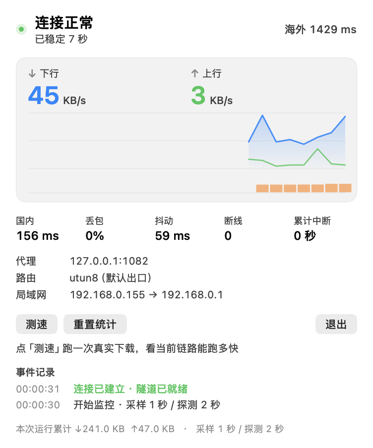

# ProxyPulse

**A tiny macOS menu bar monitor for proxy / VPN tunnels — so you can tell whether it's actually down, and how fast it really is.**

[](#)
[](#)
[](#)
[](LICENSE)



## Why

When a page hangs while your proxy icon is still lit, the usual question is: slow node? dead tunnel? or has
Wi-Fi dropped? Bandwidth monitors don't answer it, because "no traffic" is what idle looks like anyway.

ProxyPulse probes every 2 seconds along three paths, so the symptoms can be separated:

| Probe | Target | Tells you |
| --- | --- | --- |
| Overseas (via proxy) | `connectivitycheck.gstatic.com` | Whether the tunnel carries data, and the exit latency |
| Domestic (via proxy) | `www.baidu.com` | Domestic OK but overseas failing → node/rule problem, not a dead network |
| LAN | your router, port 80 | Router silent → local network is down, proxy is innocent |

## Features

- Live up/down speed right in the menu bar
- Six explicit states: healthy / jittery / tunnel down / LAN down / proxy unresponsive / proxy off
- Overseas vs domestic latency side by side
- 90-second chart: throughput curves plus one bar per probe (failed probes marked in red)
- Outage log with reason, timestamp and duration, plus cumulative downtime
- One-click real download speed test
- Zero configuration — proxy host/port read from `scutil --proxy`
- Zero dependencies — AppKit / Foundation / Darwin only, 350 KB app bundle
- Universal binary: Apple silicon and Intel

## Install

Download `ProxyPulse.dmg` from [Releases](releases) and drag the app to `/Applications`.

The build is **ad-hoc signed only** (no Apple Developer ID), so Gatekeeper will block the first launch.
Clear the quarantine flag once:

```bash
xattr -dr com.apple.quarantine /Applications/ProxyPulse.app
```

Or: double-click once, then go to **System Settings → Privacy & Security → Open Anyway**.

## Build from source

Requires Xcode Command Line Tools (`xcode-select --install`).

```bash
git clone https://github.com/li-shiji/ProxyPulse.git
cd ProxyPulse

./build.sh            # native arch only, fast
./build.sh --package  # universal (arm64 + x86_64) + dist/ProxyPulse.dmg
```

## How it works

- **Throughput** — `getifaddrs()` reads the `if_data` byte counters of physical interfaces (`en*`) and
  differences them once per second. Physical interfaces only, so TUN traffic isn't double counted;
  unsigned 32-bit wrap-around is handled with `&-`.
- **Reachability** — raw `socket()` + `poll()` speaking plain HTTP to a 204 endpoint. Deliberately no TLS,
  so the latency reading reflects round-trip time instead of handshake cost.
- **Chained scheduling** — the next probe is scheduled when the previous one finishes, not on a fixed
  2-second timer; otherwise timeouts would starve the schedule and detection would drift to 10+ seconds.
- **Cold-start guard** — the very first probe often fails due to connection/DNS warm-up and is discarded,
  so launching the app never flashes a false warning.

## Limitations

- Counts **all** traffic on the physical interface, not just proxied traffic
- Reads the **HTTP** proxy only; with SOCKS5-only setups, speed and outage detection still work but latency may be off
- Unsigned: first launch needs a manual override
- Probe targets are fixed to Google and Baidu endpoints

## Privacy

No telemetry, no uploads. All computation is local; the only network requests go to the three probe targets
listed above and to your own proxy port.

## License

[MIT](LICENSE)
