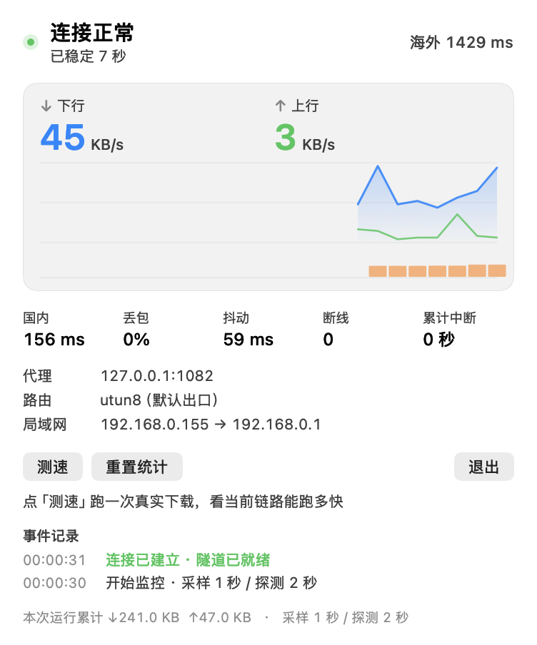

# ProxyPulse

**macOS 菜单栏上的代理链路监控 —— 用来看清「到底断没断」和「到底跑多快」。**

[](#)
[](#)
[](#)
[](#)
[](LICENSE)



---

## 它解决什么问题

用 Shadowrocket / Clash / Surge 的人大概都遇到过这种困惑：网页一直转圈，但菜单栏的代理图标还亮着——
**是节点卡了、隧道断了、还是家里 Wi-Fi 掉了？**

大部分「网速监控」只看有没有流量，可你挂着不动的时候本来就没流量，于是什么都看不出来。
ProxyPulse 的做法不一样：**每 2 秒真的发一次请求**，并且同时打三条路，用对照关系把原因分开。

| 探测 | 目标 | 能说明什么 |
| --- | --- | --- |
| 海外探测（走代理） | `connectivitycheck.gstatic.com` | 隧道到底通不通、出口延迟多少 |
| 国内探测（走代理） | `www.baidu.com` | 国内可通但海外不通 → 是节点/规则问题，不是网络断了 |
| 局域网探测 | 你的路由器 80 端口 | 路由器不响应 → 本地网络断了，跟代理无关 |

## 功能

- **菜单栏实时速率**：`↓2.8M ↑46K`，一眼可见，不用点开
- **6 种明确状态**：连接正常 / 网络不稳 / 隧道不通 / 本地网络断开 / 代理进程无响应 / 代理未开启——不用再猜
- **双路延迟对比**：海外 ms 与国内 ms 并排，判断是节点慢还是家宽慢
- **90 秒趋势图**：上下行速率曲线 + 每次探测的延迟柱条（失败的那次标红点）
- **断线记账**：事件记录写明原因、时间点、持续时长，并累计中断次数与总时长
- **一键测速**：跑一次真实下载，看当前链路实际能跑多少 Mbps
- **零配置**：自动从 `scutil --proxy` 读取代理地址和端口
- **零依赖**：纯 AppKit / Foundation / Darwin，无第三方库，`.app` 只有 350 KB
- **通用二进制**：Apple 芯片与 Intel 均可运行

## 状态是怎么判出来的

| 状态 | 判据 |
| --- | --- |
| 连接正常 | 最近探测全部成功，且丢包低于 20% |
| 网络不稳 | 最近一次探测失败，或最近若干次丢包 ≥ 20% |
| 隧道不通 | 连续 2 次失败，但局域网正常；细分为「国内通、海外不通」与「国内海外都不通」 |
| 本地网络断开 | 连续 2 次失败，且路由器也不响应 |
| 代理进程无响应 | 连本地代理端口都失败（端口未监听 / 无响应） |
| 代理未开启 | 既没有系统代理，也没有 `utun` 隧道接口 |

连续 2 次失败才判「断开」，正常情况下 **5 秒左右**就能确认；中断时长从**第一次失败**开始算，
而不是从「确认断开」开始算，恢复后记录「本次中断 8 秒」。

## 安装

### 用现成的安装包

去 [Releases](releases) 下载 `ProxyPulse.dmg`，打开后把 app 拖进「应用程序」。

**首次打开会被系统拦下**——这个项目没有 Apple 开发者签名（需要每年 99 美元的开发者账号），
只能做 ad-hoc 签名。任选一种方式放行：

```bash
# 方式 A：终端执行一次即可（所有 macOS 版本通用）
xattr -dr com.apple.quarantine /Applications/ProxyPulse.app
```

方式 B：先双击一次，被拦下后去 **系统设置 → 隐私与安全性 → 底部「仍要打开」** → 输入密码。
（macOS 14 及更早可以直接右键 app → 打开。）

### 从源码构建

需要 Xcode Command Line Tools：

```bash
xcode-select --install
```

```bash
git clone https://github.com/li-shiji/ProxyPulse.git
cd ProxyPulse

./build.sh            # 只编译本机架构，开发时用，快
./build.sh --package  # 编译 arm64 + x86_64 通用版，并打包出 dist/ProxyPulse.dmg 与 .zip
```

想开机自启：系统设置 → 通用 → 登录项 → 添加 `ProxyPulse.app`。

## 使用

- 点菜单栏图标开面板，点别处自动收起
- 「测速」跑一次真实下载；「重置统计」清零累计数据；「退出」结束程序
- 面板底部显示本次运行累计流量，可用来核对是不是真的在走流量

## 实现要点

工程上比较有意思的几处，也是这个项目只用一个 350 KB 的二进制就能跑起来的原因：

**速率采样** —— `getifaddrs()` 读物理网卡（`en*`）的 `if_data` 累计字节，1 秒取一次差值。
只统计物理网卡是为了避免 TUN 接口与真实链路重复计数；计数器是 32 位的，用无符号减法 `&-` 处理回绕，
所以拷大文件把计数器跑满也不会读错。

**连通性探测** —— 直接用 `socket()` + `poll()` 手写 HTTP 请求，走明文 204 探测点，
刻意避开 TLS 握手，这样延迟读数反映的是链路往返而不是加密开销。
两个探测用 `DispatchQueue.concurrentPerform` 并行，互不阻塞。

**链式调度** —— 探测不是固定 2 秒一次的定时器，而是**上一次结束后再排下一次**。
否则一旦探测超时（2.5 秒），固定定时器的触发会被 `isProbing` 挡掉，断线判定就会被拖到十几秒。

**冷启动保护** —— 第一个探测常常因为建连和域名解析偏慢而失败，若计入统计会在启动瞬间误报「网络不稳」，
所以首次探测失败直接丢弃。

**自适应面板** —— 面板高度按内容 `fittingSize` 计算，图表时间轴固定 90 格、右对齐生长，
数据少的时候不会把两个点拉满整个宽度。

## 已知限制

- **统计的是物理网卡总流量**，包含系统里所有 App 的流量，不是只算代理流量
- **只读 HTTP 代理**：若代理软件只开了 SOCKS5 而没开 HTTP 代理，速率与断线判定仍准确，但延迟读数可能不准
- **没有开发者签名**：首次打开需手动放行（见上文）
- 探测每 2 秒产生约几百字节流量，可忽略，但确实是联网行为
- 探测目标固定为 Google 与百度的端点，若你的环境屏蔽了它们，判定会失真

## 目录结构

```
ProxyPulse/
├── Sources/
│   ├── Net.swift          # 网卡计数、代理/路由读取、原始 socket 探针
│   ├── Monitor.swift      # 采样调度与状态机
│   ├── SpeedTester.swift  # 下载测速
│   ├── UI.swift           # 面板与自绘图表
│   ├── Debug.swift        # 命令行调试入口（--dump / --snapshot / --speedtest）
│   └── main.swift         # 菜单栏与弹窗生命周期
├── docs/
│   ├── preview.png
│   └── 使用说明.txt        # 打包进 DMG 的安装说明
├── .github/workflows/build.yml
├── build.sh
└── CHANGELOG.md
```

调试入口对改代码很有用，不需要 GUI 就能看数据：

```bash
./ProxyPulse.app/Contents/MacOS/ProxyPulse --dump 10            # 打印 10 秒采样
./ProxyPulse.app/Contents/MacOS/ProxyPulse --snapshot /tmp/a.png # 离屏渲染面板截图
./ProxyPulse.app/Contents/MacOS/ProxyPulse --speedtest           # 跑一次测速
```

还可以用环境变量模拟故障，验证状态机：

```bash
PROXYPULSE_PROXY_OVERRIDE=127.0.0.1:1      # 假装代理端口没监听 → 应判「代理进程无响应」
PROXYPULSE_PROXY_OVERRIDE=10.255.255.1:1082 # 假装地址黑洞 → 应判握手失败
PROXYPULSE_NO_PROXY=1 PROXYPULSE_NO_TUNNEL=1 # 假装没开代理 → 应判「代理未开启」
```

## 隐私

不采集、不上传任何数据。所有计算在本机完成，网络请求只发往上面表格里的三个探测目标
和你自己的代理端口。

## 许可证

[MIT](LICENSE)
